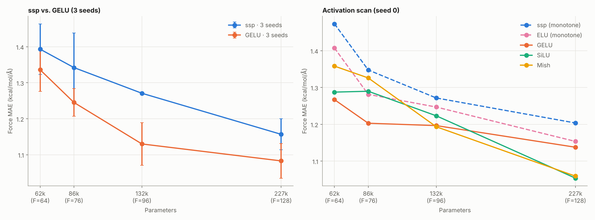
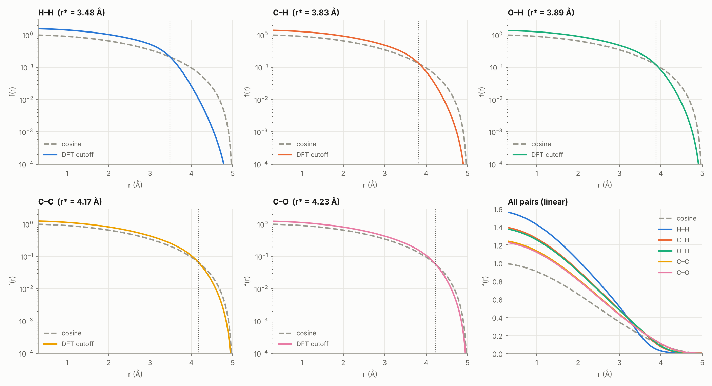
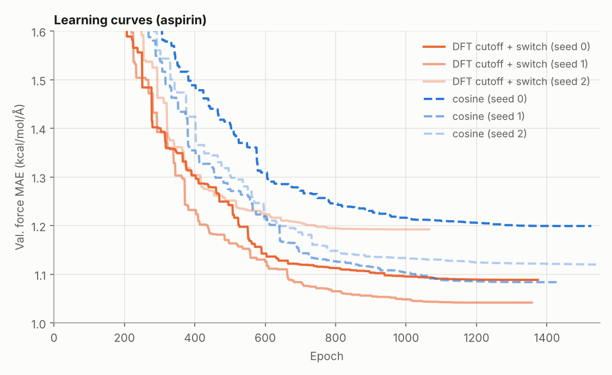

# 물리 정보를 활용한 SchNet 미세 조정

**DFT에서 유도한 cutoff, 비단조 activation**

SchNet [1]의 큰 매커니즘을 유지한 채로 어디까지 개선할 수 있을까? activation과 cutoff에 주목하였다.

| 구성 요소 | 원래 SchNet | 이 작업 |
|---|---|---|
| activation | shifted softplus | 비단조 함수 (GELU, SiLU, Mish) |
| 폭 $F$ | 64 | 64–128, 모델 크기 대비 정확도 |
| cutoff | cosine, 모든 원자쌍에 동일 | 이원자 DFT 전자밀도에서 유도, $f(r;Z,Z')$ |
| 에너지 | $\sum_i E_i$ | + 전자밀도가 더 이상 겹치지 않는 곳에서만 켜지는 쿨롱 항 |

## 주요 결과

rMD17 [2], 학습 구조 1,000개. MAE 단위는 에너지 kcal/mol, 힘 kcal/mol/Å.

1. **비단조 activation이 파라미터 효율이 더 좋다** (아스피린, seed 3개). GELU $F=96$은 shifted softplus $F=128$과 같거나 더 정확하면서 **파라미터가 42% 적다** (힘 $1.130\pm0.059$ 대 $1.157\pm0.043$, 에너지 $0.543$ 대 $0.577$).
2. **전자밀도에서 만든 cutoff** 이원자 VASP 계산 다섯 개로 fitting한, $(Z,Z',r)$만으로 정해지는 4-파라미터 식이다. 에탄올에서는 cosine cutoff와 같은 정확도를 유지하면서 더 빨리 수렴한다. 아스피린에서는(seed 하나) cosine의 seed 3개 평균보다 힘 오차가 6% 낮다.
3. **통합 모델** (GELU, $F=96$, DFT cutoff와 스위치): 힘 $1.105\pm0.074$, 에너지 $0.548\pm0.032$. 원래 SchNet 설정보다 20% 좋고, 파라미터 42% 적으면서 softplus $F=128$보다 좋다. 정답률의 기여는 폭과 activation에 의존하지만, 목표 오차까지의 epoch는 cutoff의 영향을 받는다.

---

## 1. 실험 설정

**SchNet.** 원자 간 거리를 Gaussian RBF로 전개한 뒤 연속적인 합성곱 필터를 적용한다. $m_i=\sum_{j\ne i}h_j\odot W(r_{ij})\,f(r_{ij})$. 필터 $W$는 다른 원자에게 제공할 정보를 학습하며, cutoff $f$는 이를 *얼마나* 전달할지 정한다. 힘은 $-\nabla_{\mathbf R}E$로 구한다. PyTorch로 처음부터 구현했고, 회전·평행이동 불변성과 자동미분 힘을 수치적으로 검증했다($\le 10^{-10}$).

**데이터.** rMD17 표준 분할(학습 1,000 / 테스트 1,000)에, 고정된 검증 세트 1,000개를 사용하였다.
- **에탄올** (원자 9개): 기준선과 ablation 실험. 10,000 epoch, $F=64$에서 힘 $0.340\pm0.007$로, [1]에 보고된 0.39의 경향을 잘 따른다.
- **아스피린** (원자 21개): 주요 검증. 최대 2,000 epoch, 조기 종료(patience 100)로 학습하였다. 개선된 cutoff를 활용하기 위해서는 거리가 충분히 먼 입자쌍이 필요하므로 큰 분자를 선택하였다.

---

## 2. 이론: 단조성의 근사 능력

SchNet은 조각별 선형이 아닌 softplus를 쓴다. 그러면 ReLU에 대해 증명된 폭의 한계를 벗어날 수 있을까?

**Lu et al. [4].** $\mathbb R^n$ 위의 ReLU 신경망은 폭 $n+4$면 $L^1$ 근사가 가능하고(정리 1), 폭이 $n$ 이하이면 불가능하다(정리 2). 정리 2의 증명은 신경망이 아핀인 볼록 영역을 층마다 추적하며, ReLU의 세 가지 성질을 쓴다. 문턱값 때문에 영역이 반공간이 된다는 점, 음수 입력에서 ReLU가 정확히 상수라는 점, 볼록 집합의 경계에서 0인 아핀 함수는 내부에서도 0이라는 점이다. softplus는 이 중 어느 것도 만족하지 않으므로 **증명**은 그대로 옮겨지지 않는다.

**하지만 Softplus에서도 이러한 경향은 여전히 성립한다.** 연속이고 강한 단조이며 Lipschitz인 activation과 은닉 폭 $n$에 대해 $\int_{\mathbb R^n}|g|\in\{0,\infty\}$이다.
1. 가중치 행렬이 가역이면 각 층은 단사이다. 따라서 은닉 사상은 열린 집합 위로의 위상동형사상이 되고(영역 불변성 정리), $g$는 그 사상의 아핀 함수이다.
2. 따라서 $g$의 모든 등위집합은 유계가 아니다(가중치 행렬이 특이이면 $g$는 유계가 아닌 방향을 따라 상수이다).
3. 유계가 아닌 등위집합에서 0이 아닌 Lipschitz 함수는 적분이 무한대이다.

**비단조 activation은 이 한계를 벗어난다.** 위 논증에는 단사성이 필요하다. 이미 $g(x)=\mathrm{gelu}(-\mathrm{gelu}(x))$만 해도 $\int|g|\approx0.38$이다.

즉 핵심 성질은 단조성이다. 다만 이것은 $\mathbb R^n$ 전체에서의 근사에 대한 결과이다. 유계인 입력에서는 이 장벽이 더 약하다고 알려져 있으므로, 비단조 activation이 실제로 도움이 되는지는 실험으로 확인할 문제이다(§3).

---

## 3. Activation과 폭

아스피린, cosine cutoff, seed 3개. $F=76\approx1.2\times3N$은 경험적 기준으로 넣었다. 원자 특징이 분자 내부 자유도 $3N-6=57$을 표현할 수 있어야 한다면, $F=64$는 Lu et al.의 $n+4$를 겨우 넘는 폭이다. 그런데 $n+4$는 **깊은 신경망**에서만 충분한 조건이고, SchNet은 블록이 3개뿐이다. 따라서, ssp를 activation으로 쓴다면 실질적으로 넓고 얕은 신경망으로의 근사가 유리하다. 그러나, GELU를 activation으로 사용한다면 GELU의 비단조성이 해당 정리를 회피하므로 어느 정도의 성능 향상을 기대해볼 수 있다.

| $F$ | 파라미터 | ssp 힘 | GELU 힘 | ssp 에너지 | GELU 에너지 |
|---|---|---|---|---|---|
| 64 | 62k | 1.393 ± 0.070 | 1.336 ± 0.060 | 0.687 | 0.656 |
| 76 | 86k | 1.342 ± 0.096 | 1.245 ± 0.038 | 0.666 | 0.605 |
| 96 | 132k | 1.271 ± 0.004 | **1.130 ± 0.059** | 0.639 | **0.543** |
| 128 | 227k | 1.157 ± 0.043 | 1.083 ± 0.048 | 0.577 | 0.529 |

- GELU $F=96$은 ssp $F=128$ 이상의 정확도를 42% 적은 파라미터로 얻을 수 있다. GELU $F=76$은 ssp $F=96$과 비슷한 정확도를 35% 적은 파라미터로 구현할 수 있다.
- $F=96$부터는 모든 seed에서 GELU가 낫다. 학습 오차도 GELU가 낮으므로, 일반화만 나은 게 아니라 데이터 자체를 더 잘 맞춘다.
- 폭을 늘릴수록 넓고 얕은 신경망에 가까워지므로, softplus도 성능이 향상된다. (64에서 128로 늘리면 힘 −17%).

**activation 탐색** (seed 0, 힘 MAE):

| $F$ | ssp | ELU | GELU | SiLU | Mish |
|---|---|---|---|---|---|
| 64 | 1.473 | 1.407 | **1.267** | 1.288 | 1.358 |
| 76 | 1.348 | 1.281 | **1.203** | 1.290 | 1.326 |
| 96 | 1.272 | 1.329 | 1.197 | 1.223 | **1.193** |
| 128 | 1.204 | 1.154 | 1.138 | **1.054** | 1.059 |

모든 폭에서 가장 좋은 activation은 비단조 함수이고, 평균으로도 비단조 activation이 단조 activation보다 낫다. 64, 96, 128에서는 모든 비단조 함수가 모든 단조 함수보다 낫다. 단, GELU에 비하여 fluctuation이 심한 두 activation(SiLU, Mish)과 비교하면 단순히 비단조성이 강하다고 해서 좁은 네트워크의 정확도가 증가하지 않는다.



---

## 4. 전자밀도에서 유도한 cutoff

두 원자의 cutoff는 어떻게 구성할 수 있을까? 이는 DFT의 전자밀도로부터 추정할 수 있다.

### 4.1 이원자 DFT 계산

| 설정 | 값 |
|---|---|
| 코드 | VASP [5], PAW, PBE [6] |
| 원자쌍 | H–H, C–H, O–H, C–C, C–O (에탄올에 있는 모든 쌍) |
| 거리 | 실험 결합 길이 $r_e$ + {−0.1, 0, 0.25, 0.5, 1, 1.5, 2, 2.5, 3, 4} Å, 그리고 고립 원자 |
| 셀 | $20\times15\times15$ Å 상자, Γ점, `ENCUT = 500` eV, `EDIFF = 1e-6` |
| 스핀 | `ISPIN = 2` (홀전자를 표현하기 위함) |
| 출력 | 모든 거리에서 `CHGCAR` (원자가 전자밀도) |

**검증.** 모든 쌍에서 에너지 최솟값이 실험 결합 길이와 유사하며, 결합 에너지는 PBE에 대해 알려진 과대결합 경향을 보인다(H₂ 4.52 eV, CO 11.82 eV). DFT 힘이 0.01 eV/Å 아래로 떨어지는 거리는 쌍에 따라 3.5–5 Å이다.

### 4.2 접촉 거리 $r^*$: 전자구름은 언제 떨어지는가?

전자 구름은 충분히 인접한 두 원자에서 서로 결합될 수 있다. 결합 전후로 오일러 지표가 변하기 때문에 이는 전자 밀도 상의 **topology가 변한 것**이며 두 상태에 사용되는 cutoff를 다르게 정의하기 위하여 그 경계를 조사하고자 한다.

계산한 각 거리 $r$에서:

1. 두 원자핵을 잇는 직선을 따라 밀도를 읽는다 (400개 점, `CHGCAR` 격자에서 선형 보간).
2. 그 최솟값을 취한다. 이것이 $\rho_\mathrm{BCP}(r)$, 즉 **결합 임계점**의 밀도이다. 결합 임계점은 두 핵 사이에서 결합축 방향으로는 밀도가 가장 낮고, 축에 수직인 방향으로는 가장 높은 점이다. 이원자 분자에서는 대칭 때문에 결합축 위에 있다.
3. **판단 기준:** 밀도 기준값 $c$에서 $\rho_\mathrm{BCP}\ge c$이면 두 구름이 이어져 있고, $\rho_\mathrm{BCP}<c$이면 떨어져 있다고 판정한다.
원자가 멀어질수록 $\rho_\mathrm{BCP}$는 줄어든다. 접촉 거리 $r^*$는 이 값이 다음 기준을 지나는 거리이다.

$$\rho_\mathrm{BCP}(r^*)=c=0.001\ \text{a.u.}$$

0.001 a.u.는 분자의 van der Waals 표면을 그릴 때 흔히 쓰는 밀도 값이다. 계산한 두 거리 사이에서는 $\log\rho_\mathrm{BCP}$를 선형 보간한다.

### 4.3 감쇠율 $\kappa$: 상대 원자가 전자 구름을 변형시키는가?

$r^*$를 지나면 두 구름은 떨어져 있지만, 각 원자는 여전히 상대 원자 때문에 조금 찌그러져 있다. $\kappa$는 이 찌그러짐이 거리에 따라 얼마나 빨리 사라지는지를 나타낸다.

**1단계:** 고립 원자의 밀도는 궤도 점유와 상관없이 핵을 중심으로 대칭이다. 즉 $\mathbf R+\mathbf d$에서의 밀도와 거울상 점 $\mathbf R-\mathbf d$에서의 밀도가 같다. 상대 원자는 밀도를 한쪽으로 끌거나 밀어서 이 대칭을 깬다. 비대칭도

$$A=\frac{\tfrac12\int_\Omega|\rho(\mathbf R+\mathbf d)-\rho(\mathbf R-\mathbf d)|\,d\mathbf d}{\int_\Omega\rho(\mathbf R+\mathbf d)\,d\mathbf d}$$

는 모든 점이 원점 대칭으로부터 얼마나 벗어났는지를 나타낸다. 예컨대, 고립 원자에서는 0이고, 찌그러짐이 클수록 커진다. $\Omega$는 핵을 둘러싼 껍질 $0.2<|\mathbf d|<1.0$ Å이다(최대 $r/2$). 유사밀도의 핵심부를 피하고, 두 원자의 껍질이 섞이지 않도록 하기 위함이다. 밀도는 핵을 중심으로 spline 보간하여 샘플링한다.

**2단계:** $D(r)=\tfrac12(A_A+A_B)$, 두 원자 비대칭도의 평균을 계산한다.

**3단계:** $\ln D$를 $r$에 대해 그리면, 결합 영역을 지난 점들이 직선 위에 놓이는 경향이 있다. 즉 $D\propto e^{-\kappa r}$이고 기울기가 $-\kappa$이다. 쌍마다 따로 fitting하면 다음과 같다.

| | H–H | C–H | O–H | C–C | C–O |
|---|---|---|---|---|---|
| $r^*$ (Å) | 3.51 | 3.98 | 3.60 | 4.45 | 4.13 |
| $\kappa$ (Å⁻¹) | 3.34 | 2.04 | 1.37 | 1.86 | 1.42 |

### 4.4 $(Z,Z',r)$에 대한 일반식

식은 최대한 단순하게 골랐다. 접촉 거리는 두 반지름을 더하고 감쇠율은 평균 내며, 원소마다의 반지름과 감쇠율은 $Z$의 거듭제곱으로 정한다. 새 원소를 어느 정도 예측할 수 있으면서 파라미터가 가장 적은 형태이다.

$$r^*=R_0(Z^{q}+Z'^{q}),\qquad \kappa=\tfrac12k_0(Z^{-p}+Z'^{-p})$$

측정된 $r^*$과 $D(r)$의 데이터를 활용하여 네 상수를 모두 robust(soft-$L_1$) 최소제곱으로 피팅하고, 불확도는 부트스트랩 200회로 구했다. $A$는 $\kappa$를 통해 cutoff에 들어간다.

| 상수 | 값 | 68% 구간 |
|---|---|---|
| $R_0$ (Å) | 1.742 | [1.65, 1.77] |
| $q$ | 0.100 | [0.08, 0.14] |
| $k_0$ (Å⁻¹) | 3.279 | [2.58, 3.33] |
| $p$ | 0.393 | [0.28, 0.45] |

### 4.5 cutoff 함수

$\max(\cdot)$ 역할을 할 수 있는 매끄러운 함수 $s_w(x)=w\ln(1+e^{x/w})$, $w=0.2$ Å를 쓴다. 힘과 그 기울기를 계산해야 하므로 미분 가능성이 필요하기 때문이다.

$$f(r;Z,Z')=\tfrac12\Big[\cos\tfrac{\pi r}{5\,\text{Å}}+1\Big]\exp\!\big(-\kappa\,[s_w(r-r^*)-s_w(0)]\big)$$

$r^*$ 안쪽에서는 cosine에 쌍마다 다른 상수(1.25–1.58)를 곱한 것과 같고, 바깥쪽에서는 DFT로 잰 대로 감쇠한다.



---

## 5. SchNet에 넣은 DFT cutoff

에탄올에 대한 벤치마크는 다음과 같다.

| 힘 MAE | cosine | DFT cutoff |
|---|---|---|
| 1,000 epoch (seed 3개) | 0.827 ± 0.048 | 0.725 ± 0.047 |
| 10,000 epoch, seed 0 / 1 | 0.335 / 0.338 | 0.333 / 0.344 |

DFT cutoff는 cosine cutoff에 비하여 15% 빠르게 오차가 수렴하였다. 다만, 10,000 epochs 학습에서 두 모델의 오차가 거의 같다는 점으로부터 cutoff의 조정이 모델 자체의 한계를 줄여줄 수는 없다는 것을 알 수 있다.

또한, 에탄올은 분자 자체의 사이즈가 작으므로, 각 원자쌍의 거리가 충분히 확보될 때의 상태를 따로 비교하여야 한다. 따라서, 원자가 충분히 많고 큰 아스피린을 활용하여 추가로 모델을 개선하고자 한다.

---

## 6. 장거리 항에 대한 보정

DFT에는 장거리 쿨롱 상호작용이 모두 들어 있지만, cutoff가 있는 신경망은 이를 표현할 수 없다. PhysNet [3]의 방식을 차용하여, 에너지를 학습되는 짧은 거리 부분과 해석적인 긴 거리 부분으로 나누었다.

$$E=E_\mathrm{NN}+k_e\sum_{i\lt j}\tilde q_i\tilde q_j\,\chi(r_{ij}),\qquad \tilde q_i=q_i-\tfrac1N\textstyle\sum_jq_j$$

$q_i$는 원자 $i$의 전하로, 마지막 원자 특징에 선형층을 붙여 예측한다. $\tilde q_i$는 분자 전체가 중성이 되도록 하는 유효전하이다. 이를 이용하여 극성 분자의 장거리 계산을 가능하도록 한다. $k_e=332.06$ kcal·Å/(mol·e²)이다. $\chi(r)$는 쿨롱 상호작용의 거리 인자이다. 그냥 점전하라면 $\chi(r)=1/r$이다. $\chi$를 어떻게 정하느냐가 쿨롱 항이 어느 거리에서 작용할지를 정한다. PhysNet은 짧은 거리에서 $1/r$을 완만하게 만들고($r\to0$에서 발산하지 않도록) 5 Å부터 정확히 $1/r$이 되는 고정 함수를 쓴다.

단, 이 구현을 SchNet으로 옮기면 큰 문제가 발생한다: **PhysNet은 기준 쌍극자로 전하를 학습**시키는데, rMD17에는 쌍극자가 없다. 쌍극자 없이 쓰면 PhysNet의 차폐 함수가 결합한 원자 사이에 큰 쿨롱 에너지를 남기고, 이로 인하여 정확도가 감소한다.
이를 해결하기 위하여 접촉 거리를 이용한다: 점전하는 전자밀도가 겹치지 않는 곳에서만 의미가 있고, 그 경계가 바로 $r^*$이다. 따라서 쿨롱 항은 구름이 겹친 쌍에서는 꺼지고, 떨어진 쌍에서는 켜져야 한다. 또한, DFT 계산식으로부터 장거리 항의 정보를 얻을 수 있으므로 이러한 스위칭에는 문제가 없다.

$$\chi(r)=\frac{1-g(r)}{r},\qquad g(r)=\exp\!\big(-\kappa[s_w(r-r^\ast)-s_w(-r^\ast)]\big)$$

- $g(r)$는 **겹침 지표**이다. 두 구름이 겹쳐 있는 동안($r<r^*$) 약 1이고, 그 뒤로 §4.3에서 잰 감쇠율 $\kappa$로 0까지 줄어든다. DFT cutoff(§4.5)의 감쇠 인자와 같은 모양이고, 같은 $r^*(Z,Z')$와 $\kappa(Z,Z')$를 쓴다.
- 따라서 $1-g(r)$는 구름이 겹친 쌍에서 0, 충분히 떨어진 쌍에서 1이다.
- $\chi(r)=(1-g)/r$는 이것으로 켜고 끈 쿨롱 인자이다. $r^*$ 안쪽에서는 0이고, 멀리 떨어지면 정확히 $1/r$이다.

정리하면, $r^*$ 안쪽에서는 신경망만 그 쌍을 다루고, 바깥쪽에서는 신경망의 기여가 cutoff로 줄어드는 대신 cutoff가 덜어낸 몫($1-g$)을 쿨롱 항이 넘겨받는다.

| 아스피린, seed 0만 | 에너지 | 힘 |
|---|---|---|
| cosine | 0.725 | 1.473 |
| cosine + DFT 스위치 | 0.659 | 1.332 |
| DFT cutoff | 0.652 | 1.311 |
| DFT cutoff + DFT 스위치 | 0.637 | 1.320 |

성능 저하가 사라진다. cutoff와 정전기 항은 비슷한 크기의 개선을 주지만, 둘을 합쳐도 효과가 거의 더해지지 않는다. 둘 다 $r^*$ 너머의 원자쌍에 작용하기 때문이다.

전하는 물리적 부분전하가 아니라 유효 전하이다. 쿨롱 에너지는 $q\to-q$로 바꿔도 변하지 않으므로, 쌍극자 정답이 없으면 전하 전체의 부호가 정해지지 않는다. 실제로 seed마다 반대 부호로 수렴했다($q_\mathrm H\approx\pm0.2$, $q_\mathrm C\approx\mp0.17$, $q_\mathrm O\approx0$ e). 재현되는 것은 패턴(H와 C가 반대 부호, O는 0 근처)뿐이다.

---

## 7. 통합 모델

| 모델 | 파라미터 | 에너지 | 힘 |
|---|---|---|---|
| ssp, cosine, $F=64$ (원래) | 62k | 0.687 ± 0.033 | 1.393 ± 0.070 |
| ssp, cosine, $F=128$ | 227k | 0.577 ± 0.015 | 1.157 ± 0.043 |
| GELU, cosine, $F=96$ | 132k | 0.543 ± 0.014 | 1.130 ± 0.059 |
| GELU, DFT cutoff + 스위치, $F=96$ | 132k | 0.548 ± 0.032 | 1.105 ± 0.074 |

통합 모델은 원래 설정보다 힘과 에너지 모두 20% 정확하고, softplus $F=128$보다 파라미터 42% 적으면서 5% 정확하다. 하지만 같은 폭의 GELU + cosine cutoff와 비교하면 DFT cutoff와 스위치가 정확도에 일관된 개선을 더하지 못한다. 그러나, 수렴은 DFT cutoff를 적용한 모델이 200 epochs가량 빠를 수 있음을 알 수 있었다.



---

## 8. 한계와 다음 단계

- epoch가 대개 2,000 정도로 충분하지 않았다. seed는 최대 3개이고, 일부 결과는 seed 하나이다. 에탄올에서는 짧은 예산에서 보였던 cutoff의 이점이 충분히 학습하자 사라졌다.
- DFT에 사용한 PBE는 늘어난 이종 원자 결합에서 알려진 오차가 있고 분산력이 없다(rMD17 정답 데이터와는 일치한다). $Z$ 거듭제곱 법칙은 H, C, O만으로 fitting했다.
- equivariant 성질 등, 거리만으로 학습하는 과정에서 사라지는 정보로 인하여 학습에 분명한 한계가 있다.
- Swish-β($x\,\sigma(\beta x)$ 등 비단조성을 제어할 수 있는 activation을 이용한 실험, 더 나은 보편식 검증 등을 설계해볼 수 있다.

---

## 9. 재현 방법

```
schnet.py        SchNet, cutoff (cosine / DFT), 정전기 항
train.py         모든 rMD17 분자에 대한 학습과 평가
test_schnet.py   불변성과 힘 검사
dft/             VASP 입력 생성, cutoff fitting (CHGCAR 읽음)
results/         CSV 결과, epoch별 기록
```

단, dft/와 results/에 해당하는 부분은 데이터 가공 이후 일부 공개할 예정이다.

스크립트 실행은 다음과 같이 할 수 있다.

```bash
python test_schnet.py
python train.py --data data/rmd17_aspirin.npz --width 96 --act gelu --cutoff_mode universal --elec --elec_mode dft --epochs 2000 --seed 0
```

데이터: rMD17 (figshare 12672038).

---

## 10. AI 도구 사용

Claude를 코딩과 글쓰기 보조로 사용했다. DFT 피팅, 학습 코드 확장, 그래프, 문헌 검색, 이 README의 초안에 해당된다.

연구 질문, 수식 논증, DFT로 cutoff를 유도한다는 아이디어, VASP 계산, SchNet 구현, 실험 설계와 결과 해석은 직접 수행하였다.

---

## 참고문헌

1. K. T. Schütt et al., "SchNet – A deep learning architecture for molecules and materials," *J. Chem. Phys.* **148**, 241722 (2018).
2. A. S. Christensen, O. A. von Lilienfeld, "On the role of gradients for machine learning of molecular energies and forces," *Mach. Learn.: Sci. Technol.* **1**, 045018 (2020).
3. O. T. Unke, M. Meuwly, "PhysNet: A neural network for predicting energies, forces, dipole moments, and partial charges," *J. Chem. Theory Comput.* **15**, 3678 (2019).
4. Z. Lu, H. Pu, F. Wang, Z. Hu, L. Wang, "The expressive power of neural networks: A view from the width," *NeurIPS* (2017).
5. G. Kresse, J. Furthmüller, "Efficient iterative schemes for ab initio total-energy calculations using a plane-wave basis set," *Phys. Rev. B* **54**, 11169 (1996).
6. J. P. Perdew, K. Burke, M. Ernzerhof, "Generalized gradient approximation made simple," *Phys. Rev. Lett.* **77**, 3865 (1996).
